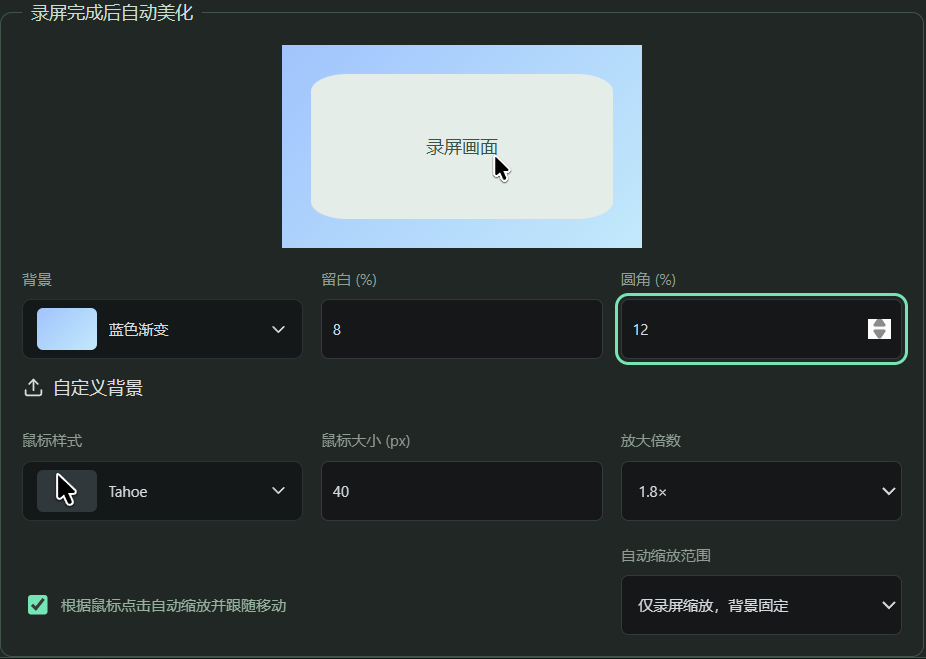
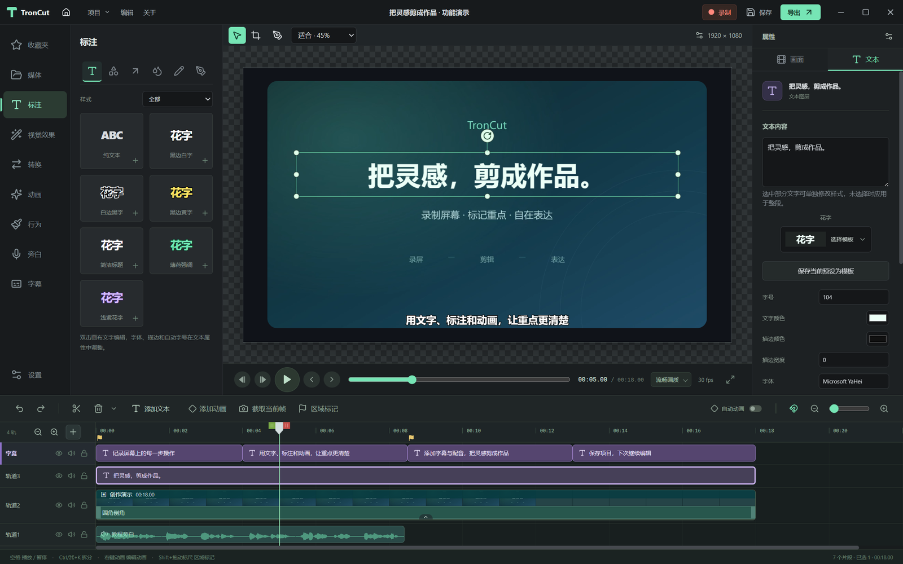
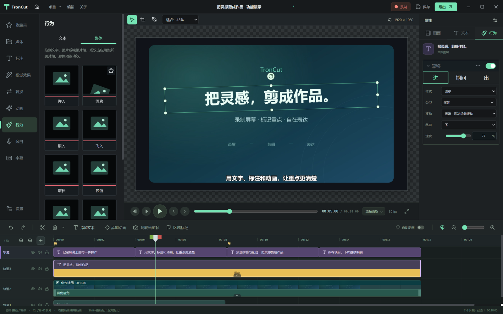
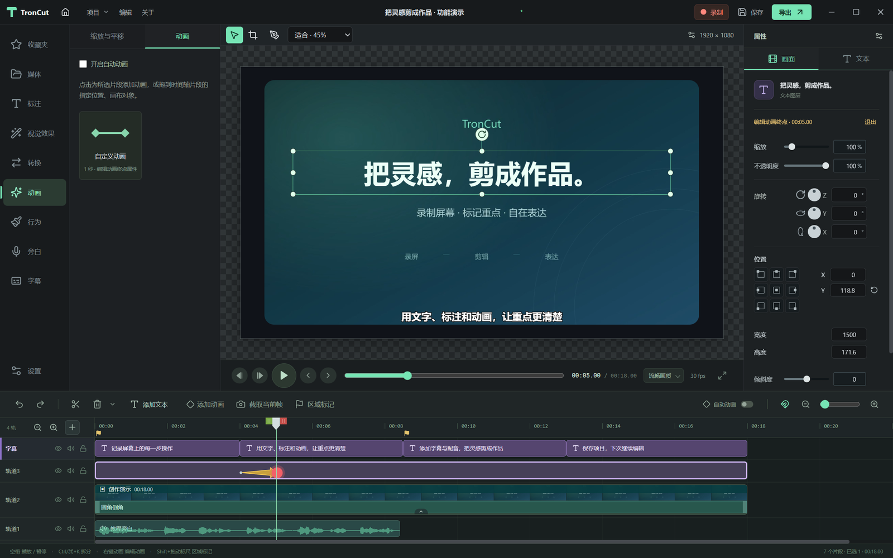
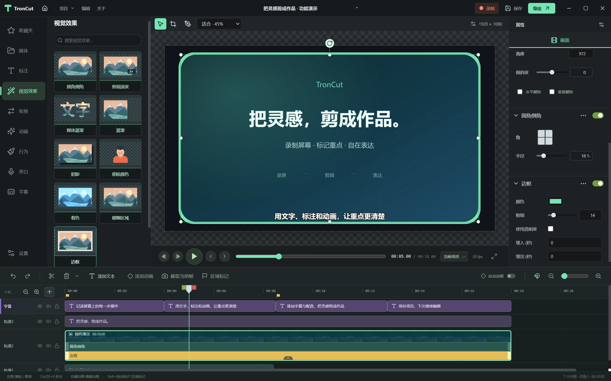
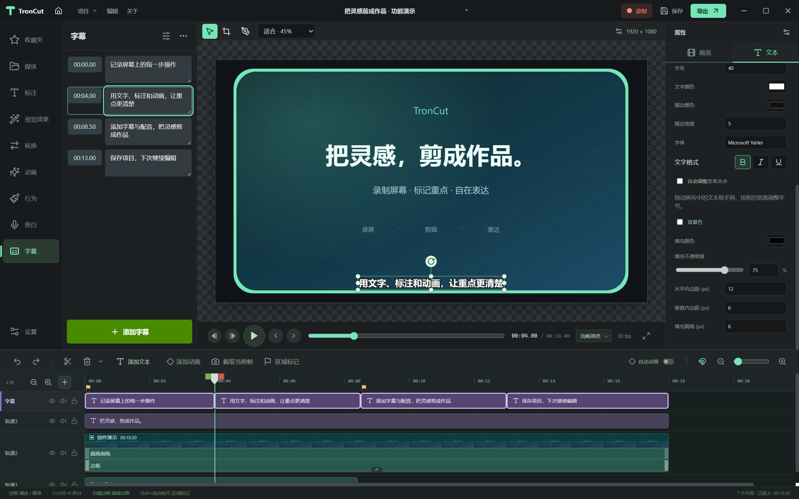
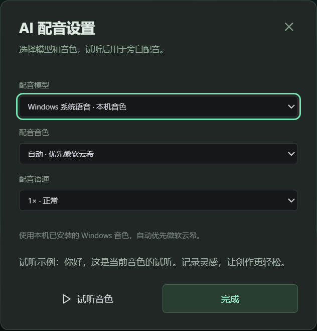
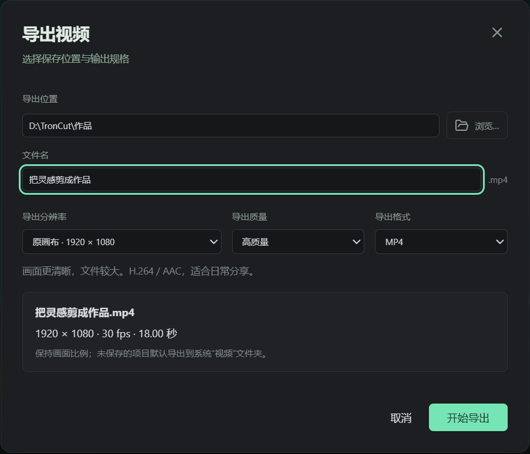

<div align="center">
  
  <h1>TronCut</h1>
  <p><strong>Record your screen. Edit with ease. Make your ideas visible.</strong></p>
  <p>A local desktop workspace for tutorials, demos, and text-based videos.</p>
  <p>
    <a href="https://github.com/Achuan-2/TronCut/releases"></a>
    <a href="LICENSE"></a>
    
    
  </p>
  <p><a href="README.md">简体中文</a> · <strong>English</strong></p>
  <p><a href="https://github.com/Achuan-2/TronCut/releases">Download</a> · <a href="#highlights">Highlights</a> · <a href="#screenshots">Screenshots</a> · <a href="docs/FEATURES.md">Roadmap</a> · <a href="https://github.com/Achuan-2/TronCut/issues">Report an issue</a></p>
</div>


TronCut brings screen recording, editing, text, captions, and audio processing into one workspace. Its media library, canvas, inspector, and multitrack timeline use a familiar desktop editing layout, with particular attention to adding text, creating animations, positioning captions, and moving projects between machines.


## Highlights

| Capability                                   | What you can do                                                                                                                                                                               |
| -------------------------------------------- | --------------------------------------------------------------------------------------------------------------------------------------------------------------------------------------------- |
| **Edit the cursor after recording**          | Windows native recording stores cursor data separately. Choose Recordly macOS, Tahoe, Windows 11, Figma and dot styles; preserve text and pointer shapes, resize or hide the cursor, and enable click highlights. |
| **Automatic zoom and recording backgrounds** | Recordly click clustering, cursor follow and spring motion generate editable camera paths. Zoom the recording alone or its background too; choose animated backgrounds, gradients, or a custom image. |
| **Custom recording regions** | Draw a region on the selected screen, resize it, or enter pixel coordinates. A small countdown keeps other apps usable, and the recording toolbar can be minimized and restored. |
| **Recording objects** | Each recording becomes one timeline object. Change its background from a dropdown, edit padding, corners and cursor styles, or ungroup it to edit the original media separately. |
| **Add text beside the timeline**             | Insert text in one click with white text with black outlines, black text with white outlines, and yellow text with black outlines. Center captions on the canvas to create text-based videos. |
| **Animate without drag-only controls**       | Add fade, zoom, and slide animations from the context menu or presets. Auto animation records keyframes when you change position, scale, or opacity.                                          |
| **Local speech captions**                    | Qwen3-ASR 0.6B and SenseVoiceSmall transcribe the whole timeline mix, preserving trimming, speed, gaps, and volume, and create a separate caption track. |
| **Local narration and voice cloning**        | Windows voices, Kokoro/VITS ONNX, and LuxTTS ONNX. Import or record a reference voice, save it locally, and reuse it for previews and narration. |
| **Pitch-preserving speed and podcast audio** | Export prefers Rubber Band for pitch preservation. Audio processing includes noise reduction, EQ, compression, loudness adjustment, and a processed audition.                                 |
| **Readable, portable projects**              | Readable JSON projects collect media and cursor data in one folder using relative paths, with a custom folder icon on Windows.                                                                |

TronCut also provides multitrack editing, multiple selection, grouping, synchronized moves, splitting, snapping, ripple deletion, undo/redo, crop and rotation, color and blur effects, fades, thumbnails, overview waveforms, and missing-media relinking. MP4 export tries an available hardware encoder before falling back to software encoding.

## Download and get started

Download from **[GitHub Releases](https://github.com/Achuan-2/TronCut/releases)**:

The current version is **[v0.6.2](https://github.com/Achuan-2/TronCut/releases/tag/v0.6.2)**, adding Markdown formulas with local colors, Edit All Animations, timeline clip colors, and customizable shortcuts, with improvements to recording storage, preview proxies, and timeline editing. This rebuild adds effect removal and copy/paste, and fixes property editing during animation holds. See the [release notes](docs/releases/v0.6.2.md).


Packages include the matching media engine and speech environment manager; Windows also includes native recording helpers. End users do not need to install Node.js, FFmpeg, or uv. **The first speech-caption task needs internet access to download Python, dependencies, and models**; speech recognition then runs locally. Windows and macOS builds are unsigned, and the macOS packages are neither notarized nor validated on real hardware.

See the [user documentation](docs/README.md) for media, recording cursors, timeline editing, text, canvas animation, and project management. Start with [Getting started](docs/GETTING-STARTED.md). These guides currently use Chinese to match the application UI.

## Screenshots

These are actual Windows desktop screenshots using one demonstration project. The application UI shown here is Chinese.

### Recording styles and automatic zoom

Choose a background, padding, corners, and cursor style before recording. Enable click-based zoom and cursor follow, then adjust the recording object's appearance after capture. [Recording and cursor guide](docs/MEDIA.md)



### Text and annotations

Drag in a text preset and edit its content on the canvas. Adjust fonts, colors, outlines, or selected characters, and save styles as reusable presets. Annotations also include shapes, arrows, blur and highlights, sketch motion, and freehand drawing. [Text and annotations](docs/TEXT.md)



### Media and text behaviors

Preview a preset on hover, drag it onto a clip, then adjust its incoming, during, and outgoing phases. Applying a new media behavior replaces the previous behaviors on that clip. [Behavior guide](docs/BEHAVIORS.md)



### Keyframe animation

Add a custom animation, adjust its range on the timeline, and edit the start and end position, scale, and opacity. Auto animation and the zoom-and-pan viewport provide additional ways to create motion. [Canvas and animation](docs/CANVAS.md)



### Visual effects

Combine rounded corners, borders, shadows, masks, tint, and regional blur. When corners and a border are enabled together, the border follows the rounded outline. [Visual effects](docs/VISUAL-EFFECTS.md)



### Caption editing

Edit captions in a list linked to the playhead, find and replace text, or apply a consistent font, outline, and background. Captions occupy a separate track, with local speech recognition and subtitle file import and export available. [Getting started](docs/GETTING-STARTED.md)



### Local narration

Enter a script, choose a model, voice, and speed, then preview or generate narration for the timeline. Supported engines include Windows voices, Kokoro/VITS ONNX, and LuxTTS ONNX voice cloning. The screenshot shows local Windows voice settings. [Local narration](docs/TTS.md)



### Video export

Choose the destination, filename, resolution, quality, and format, and review output dimensions, frame rate, and duration before export. Keep the editable project for later revisions. [Export guide](docs/EXPORT.md)



## Compatibility

| Item                             | Current status                                                                                                                                                                                       |
| -------------------------------- | ---------------------------------------------------------------------------------------------------------------------------------------------------------------------------------------------------- |
| Windows x64                      | Installer and packaged desktop workflows tested; real-device synchronization, long sessions, and 4K stress testing remain outstanding.                                                               |
| macOS                            | Apple Silicon and Intel DMGs are provided unsigned and unnotarized; installation, permissions, recording, and export remain for users to validate.                                                   |
| Camtasia `.tscproj`              | Converts common media references, flat clips, timing, speed, and some transforms. An import report and the original JSON are retained.                                                               |
| TREC and proprietary backgrounds | **Complete import is not supported.** A real project test skipped three TREC recordings and a water-ripple background; only the music was converted.                                                 |
| Speech engines                   | Qwen3-ASR 0.6B INT8, SenseVoiceSmall and Kokoro/VITS use sherpa-onnx on CPU; LuxTTS voice cloning uses ONNX Runtime on CPU, without PyTorch. |
| Voice enhancement                | DSP processing is available. Canvas playback uses the original audio; processed audition and export use the filters. AI voice reconstruction is not included.                                        |

A complete effects library, nested sequences, TREC cursor metadata, proxy media, a shared GPU compositor, and GIF/audio/interactive exports remain unfinished. Hardware encoding does not mean the entire pipeline is GPU accelerated. Professional audio blind tests and large-project performance comparisons have not been completed.

## Local development

Version 0.4.1 includes a headless CLI for Codex: editing plans, frame sampling, transcription, narration, captions, and MP4 export return structured JSON and preserve editable projects. Codex writes a timed script from sampled frames, then the CLI renders the narration and captions. See [CLI documentation](docs/CLI.md).

```sh
pnpm build
pnpm --silent cli help
pnpm --silent cli run --plan plan.json
```

Use **Node.js 22+, pnpm, and Rust 1.85+**. Install the Wasm target with `rustup target add wasm32-unknown-unknown`. Speech development uses **uv and Python 3.11/3.12**. Windows native helpers require the Visual Studio 2022 C++ toolchain, Windows SDK 10.0.22621+, and CMake. Timeline queries use the Rust engine; see [migration scope and benchmarks](docs/RUST-ENGINE.md).

```sh
git clone https://github.com/Achuan-2/TronCut.git
cd TronCut
pnpm install --frozen-lockfile
pnpm dev
```

For development, FFmpeg/FFprobe can be found on PATH; installed builds use their bundled engines. Standalone binaries are not committed to Git; see [building and releases](docs/BUILDING.md) for packaging prerequisites. Vite alone previews the interface; file access, recording, and export require Electron.

```sh
pnpm build          # Typecheck and build the editor and Electron processes
pnpm test           # Core logic and actual FFmpeg tests; media engines required
pnpm test:smoke     # Electron desktop regression; run build and test first
```

## Documentation and contributing

- [User documentation and modules](docs/README.md) · [Getting started](docs/GETTING-STARTED.md)
- [Feature checklist and roadmap](docs/FEATURES.md) · [Architecture and project format](docs/ARCHITECTURE.md)
- [Building and releases](docs/BUILDING.md) · [Validation record](docs/VALIDATION.md)
- [Local speech captions](docs/SENSEVOICE.md) · [Real Camtasia project test](docs/CAMTASIA-REAL-PROJECT-TEST.md)
- [Performance optimizations](docs/PERFORMANCE-IMPROVEMENTS.md) ⚡ **New**
- [Contribution guide](CONTRIBUTING.md) · [Open an issue](https://github.com/Achuan-2/TronCut/issues/new/choose)

Reproducible bugs, compatibility samples, test results, and code improvements are welcome. Remove private media and sensitive information before sharing projects or logs. Detailed engineering documents are currently primarily in Chinese.

## License and acknowledgements

Original TronCut code is licensed under **[AGPL-3.0](LICENSE)**. Third-party source, binaries, and models retain their own licenses; see [THIRD_PARTY_NOTICES.md](THIRD_PARTY_NOTICES.md). Camtasia is a TechSmith product name. TronCut is an independent project and is not affiliated with or endorsed by TechSmith.

Thanks to [OpenScreen](https://github.com/getopenscreen/openscreen) for its MIT native capture components, and to [FFmpeg](https://ffmpeg.org/), [Rubber Band](https://breakfastquay.com/rubberband/), [Qwen3-ASR](https://github.com/QwenLM/Qwen3-ASR), [SenseVoice](https://github.com/QwenAudio/SenseVoice), [FunASR](https://github.com/modelscope/FunASR), [uv](https://github.com/astral-sh/uv), Electron, React, and sharp. Additional study references and pinned commits are listed in [references/README.md](references/README.md).
