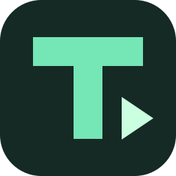
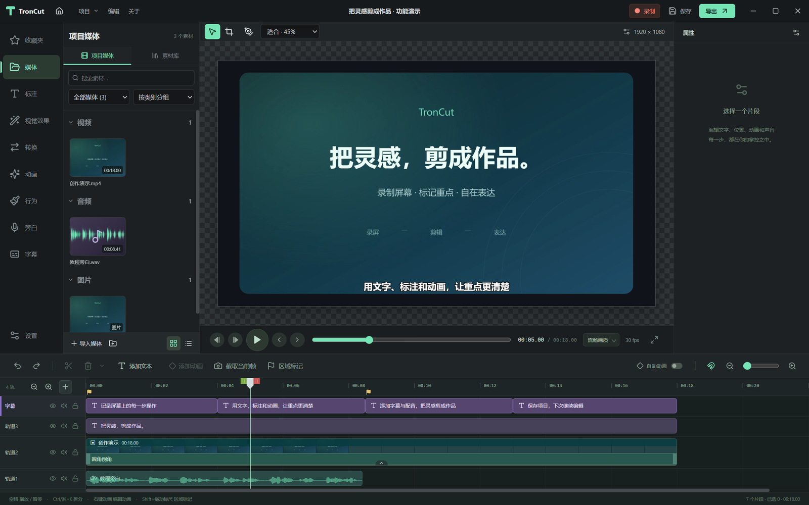

<div align="center">
  
  <h1>TronCut</h1>
  <p><strong>Record your screen. Edit with ease. Make your ideas visible.</strong></p>
  <p>A local desktop workspace for tutorials, demos, and text-based videos.</p>
  <p>
    <a href="https://github.com/Achuan-2/TronCut/releases"></a>
    <a href="LICENSE"></a>
    
    
  </p>
  <p><a href="README.md">简体中文</a> · <strong>English</strong></p>
  <p><a href="https://github.com/Achuan-2/TronCut/releases/tag/v0.4.8">Download</a> · <a href="#highlights">Highlights</a> · <a href="docs/FEATURES.md">Roadmap</a> · <a href="https://github.com/Achuan-2/TronCut/issues">Report an issue</a></p>
</div>



TronCut brings screen recording, editing, text, captions, and audio processing into one workspace. Its media library, canvas, inspector, and multitrack timeline use a familiar desktop editing layout, with particular attention to adding text, creating animations, positioning captions, and moving projects between machines.

> **Current version: v0.4.8 release.** The Windows package has passed desktop checks. Unsigned Intel and Apple Silicon macOS packages are provided without real-device validation for users to test. Camtasia import remains limited. This release does not provide complete Camtasia feature parity; see [compatibility](#compatibility). The application UI is currently Chinese; this README is available in both languages.

## Highlights

| Capability                                   | What you can do                                                                                                                                                                               |
| -------------------------------------------- | --------------------------------------------------------------------------------------------------------------------------------------------------------------------------------------------- |
| **Edit the cursor after recording**          | Windows native recording stores cursor data separately. Choose Recordly macOS, Tahoe, Windows 11, Figma and dot styles; preserve text and pointer shapes, resize or hide the cursor, and enable click highlights. |
| **Automatic zoom and recording backgrounds** | Recordly click clustering, cursor follow and spring motion generate editable camera paths. Zoom the recording alone or its background too; choose animated backgrounds, gradients, or a custom image. |
| **Custom recording regions** | Draw a region on the selected screen, resize it, or enter pixel coordinates. A small countdown keeps other apps usable, and the recording toolbar can be minimized and restored. |
| **Recording objects** | Each recording becomes one timeline object. Change its background from a dropdown, edit padding, corners and cursor styles, or ungroup it to edit the original media separately. |
| **Add text beside the timeline**             | Insert text in one click with white text with black outlines, black text with white outlines, and yellow text with black outlines. Center captions on the canvas to create text-based videos. |
| **Animate without drag-only controls**       | Add fade, zoom, and slide animations from the context menu or presets. Auto animation records keyframes when you change position, scale, or opacity.                                          |
| **Local speech captions**                    | Qwen3-ASR 0.6B and SenseVoiceSmall transcribe the whole timeline mix, preserving trimming, speed, gaps, and volume, and create a separate caption track. |
| **Local narration and voice cloning**        | Windows voices, Kokoro/VITS ONNX, and LuxTTS ONNX. Import or record a reference voice, save it locally, and reuse it for previews and narration. |
| **Pitch-preserving speed and podcast audio** | Export prefers Rubber Band for pitch preservation. Audio processing includes noise reduction, EQ, compression, loudness adjustment, and a processed audition.                                 |
| **Readable, portable projects**              | Readable JSON projects collect media and cursor data in one folder using relative paths, with a custom folder icon on Windows.                                                                |

TronCut also provides multitrack editing, multiple selection, grouping, synchronized moves, splitting, snapping, ripple deletion, undo/redo, crop and rotation, color and blur effects, fades, thumbnails, overview waveforms, and missing-media relinking. MP4 export tries an available hardware encoder before falling back to software encoding.

## Download and get started

Download from **[GitHub Releases](https://github.com/Achuan-2/TronCut/releases/tag/v0.4.8)**:

| File                                  | Purpose                                                           |
| ------------------------------------- | ----------------------------------------------------------------- |
| `TronCut-Setup-0.4.8-windows-x64.exe` | Windows x64 installer with a configurable installation directory. |
| `TronCut-0.4.8-windows-x64.zip`       | Portable build; extract the entire archive and run `TronCut.exe`. |
| `TronCut-0.4.8-macos-arm64.dmg`       | Apple Silicon Mac package; not validated on a real device.        |
| `TronCut-0.4.8-macos-x64.dmg`         | Intel Mac package; not validated on a real device.                |
| `SHA256SUMS.txt`                      | SHA256 checksums for release files.                               |

Packages include the matching media engine and speech environment manager; Windows also includes native recording helpers. End users do not need to install Node.js, FFmpeg, or uv. **The first speech-caption task needs internet access to download Python, dependencies, and models**; speech recognition then runs locally. Windows and macOS builds are unsigned, and the macOS packages are neither notarized nor validated on real hardware.

See the [user documentation](docs/README.md) for media, recording cursors, timeline editing, text, canvas animation, and project management. Start with [Getting started](docs/GETTING-STARTED.md). These guides currently use Chinese to match the application UI.

## Compatibility

| Item                             | Current status                                                                                                                                                                                       |
| -------------------------------- | ---------------------------------------------------------------------------------------------------------------------------------------------------------------------------------------------------- |
| Windows x64                      | Installer and packaged desktop workflows tested; real-device synchronization, long sessions, and 4K stress testing remain outstanding.                                                               |
| macOS                            | Apple Silicon and Intel DMGs are provided unsigned and unnotarized; installation, permissions, recording, and export remain for users to validate.                                                   |
| Camtasia `.tscproj`              | Converts common media references, flat clips, timing, speed, and some transforms. An import report and the original JSON are retained.                                                               |
| TREC and proprietary backgrounds | **Complete import is not supported.** A real project test skipped three TREC recordings and a water-ripple background; only the music was converted.                                                 |
| Speech engines                   | Qwen3-ASR 0.6B INT8, SenseVoiceSmall and Kokoro/VITS use sherpa-onnx on CPU; LuxTTS voice cloning uses ONNX Runtime on CPU, without PyTorch. |
| Voice enhancement                | DSP processing is available. Canvas playback uses the original audio; processed audition and export use the filters. AI voice reconstruction is not included.                                        |

A complete effects library, nested sequences, TREC cursor metadata, proxy media, a shared GPU compositor, and GIF/audio/interactive exports remain unfinished. Hardware encoding does not mean the entire pipeline is GPU accelerated. Professional audio blind tests and large-project performance comparisons have not been completed.

## Local development

Version 0.4.1 includes a headless CLI for Codex: editing plans, frame sampling, transcription, narration, captions, and MP4 export return structured JSON and preserve editable projects. Codex writes a timed script from sampled frames, then the CLI renders the narration and captions. See [CLI documentation](docs/CLI.md).

```sh
pnpm build
pnpm --silent cli help
pnpm --silent cli run --plan plan.json
```

Use **Node.js 22+, pnpm, and Rust 1.85+**. Install the Wasm target with `rustup target add wasm32-unknown-unknown`. Speech development uses **uv and Python 3.11/3.12**. Windows native helpers require the Visual Studio 2022 C++ toolchain, Windows SDK 10.0.22621+, and CMake. Timeline queries use the Rust engine; see [migration scope and benchmarks](docs/RUST-ENGINE.md).

```sh
git clone https://github.com/Achuan-2/TronCut.git
cd TronCut
pnpm install --frozen-lockfile
pnpm dev
```

For development, FFmpeg/FFprobe can be found on PATH or selected in Settings. Standalone binaries are not committed to Git; see [building and releases](docs/BUILDING.md) for packaging prerequisites. Vite alone previews the interface; file access, recording, and export require Electron.

```sh
pnpm build          # Typecheck and build the editor and Electron processes
pnpm test           # Core logic and actual FFmpeg tests; media engines required
pnpm test:smoke     # Electron desktop regression; run build and test first
```

## Documentation and contributing

- [User documentation and modules](docs/README.md) · [Getting started](docs/GETTING-STARTED.md)
- [Feature checklist and roadmap](docs/FEATURES.md) · [Architecture and project format](docs/ARCHITECTURE.md)
- [Building and releases](docs/BUILDING.md) · [Validation record](docs/VALIDATION.md)
- [Local speech captions](docs/SENSEVOICE.md) · [Real Camtasia project test](docs/CAMTASIA-REAL-PROJECT-TEST.md)
- [Performance optimizations](docs/PERFORMANCE-IMPROVEMENTS.md) ⚡ **New**
- [Contribution guide](CONTRIBUTING.md) · [Open an issue](https://github.com/Achuan-2/TronCut/issues/new/choose)

Reproducible bugs, compatibility samples, test results, and code improvements are welcome. Remove private media and sensitive information before sharing projects or logs. Detailed engineering documents are currently primarily in Chinese.

## License and acknowledgements

Original TronCut code is licensed under **[AGPL-3.0](LICENSE)**. Third-party source, binaries, and models retain their own licenses; see [THIRD_PARTY_NOTICES.md](THIRD_PARTY_NOTICES.md). Camtasia is a TechSmith product name. TronCut is an independent project and is not affiliated with or endorsed by TechSmith.

Thanks to [OpenScreen](https://github.com/getopenscreen/openscreen) for its MIT native capture components, and to [FFmpeg](https://ffmpeg.org/), [Rubber Band](https://breakfastquay.com/rubberband/), [Qwen3-ASR](https://github.com/QwenLM/Qwen3-ASR), [SenseVoice](https://github.com/QwenAudio/SenseVoice), [FunASR](https://github.com/modelscope/FunASR), [uv](https://github.com/astral-sh/uv), Electron, React, and sharp. Additional study references and pinned commits are listed in [references/README.md](references/README.md).
